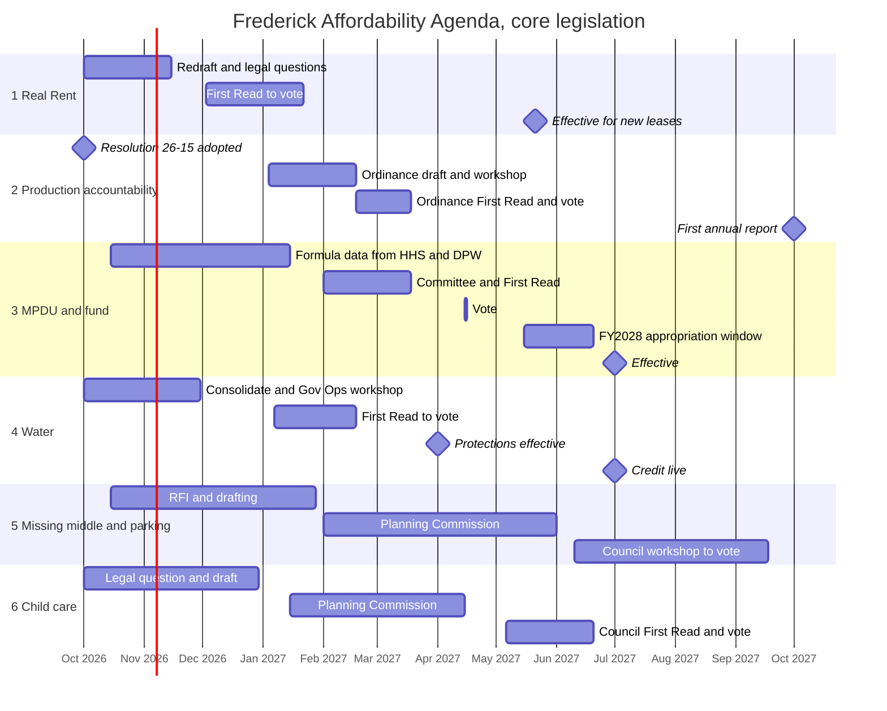

# Frederick Affordability Agenda 2026-2029

The **Frederick Affordability Agenda** is a legislative plan for the Frederick City Council under Council President César Díaz (64th Administration), covering the period from October 2026 through the end of the term in December 2029. It consists of six measures, all of them ordinances, selected because each rests on an identifiable grant of power in the City Charter or City Code, each lowers a recurring cost for working households or expands the supply of something they cannot afford, and each can realistically reach a vote within the next twelve months. Housing is the largest share because it is where the Council's authority is deepest; water and child care are included because they are the two non-housing household costs where the Council holds direct legal levers.

| | |
|---|---|
| **Sponsor** | Council President César Díaz, with named co-sponsors per item |
| **Period** | October 2026 to December 2029; core legislation October 2026 to September 2027 |
| **Items** | 6 ordinances, building on adopted Resolution 26-15 |
| **Authority** | Charter Art. II § 4; Art. IV §§ 1-2; Art. VII §§ 5, 8, 10; Art. XI § 2; Art. XIII; Art. XIV. City Code Ch. 4, 12.5, 19, 25; LMC §§ 404, 607, 802, 811 |
| **Votes to pass** | Majority present and voting |
| **Votes to survive a veto** | 5 of 7 |
| **New General Fund cost** | Concentrated in the FY2028 budget (housing fund appropriation, water credit) and FY2029 (child care pilot) |
| **Legal reference** | [[Council Legal Authority for Affordability]] |

## Contents

1. Background
2. Legal basis
3. How the six items were chosen
4. The agenda
5. Sequencing and timeline
6. Obstacles
7. What the agenda does not include, and why
8. Administrative actions that support the agenda
9. Corrections to the vault record
10. Open questions to verify
11. See also
12. Sources

---

## 1. Background

### 1.1 The affordability problem in Frederick

According to the United Way ALICE report (2024 data), **43% of City households** fall below the ALICE threshold for basic needs, against 32% countywide. The City rate held from the prior year while the number of City households below the threshold grew by about 500, even as the County improved. The Frederick County survival budget is $50,868 for a single adult and $121,080 for a family of four, and child care ($2,500 a month) now exceeds housing ($2,250) for a family with two young children. 75% of single mothers and 44% of senior households are below the threshold, and 72% of children in rental units were in ALICE or poverty households as of the 2023 data ([[ALICE 2026 Report Policy Brief 2026-09-30]], [[ALICE Report -- Frederick County 2025 (2023 Data) -- Reference Note]], [[Cesar Context -- Council]]).

On housing specifically, the TPMA Housing Data Report (February 2026) found about half of renter households cost-burdened and a quarter severely cost-burdened, a 3.1% rental vacancy rate against 5.1% statewide, and a need for **13,774 new units by 2035**. The Mayor's Affordable Housing Task Force (July 2026) projects that full implementation of its own recommendations would produce about 4,000 units in ten years ([[MAHTF Final Report Policy Brief -- 2026-07-16]], [[Workshop Brief - Affordable Housing Action Resolution 2026-09-10]]). DHCD's 2030 targets assign the City 5,194 units from 2026 to 2030 ([[Housing -- In-Progress Plans]]).

District 2, César's district, has a poverty rate 1.5 times the county's and a foreign-born share 1.4 times the county's, with median household income about 75% of the county median.

### 1.2 What the Council has already done

In the first ten months of the term the Council passed the City Values Act (G-26-1, 7-0), the Housing Certainty Act implementation ordinance (G-26-11, 5-0), the vertical mixed-use first-floor residential amendment (6-0), and the Gateway rezoning (5-1). Real Rent was workshopped July 9. The Affordable Housing Action Resolution (Resolution 26-15) passed 6-0 on October 1, 2026. Nash's ADU ordinance and Brehm's Housing Solutions Fund ordinance are in workshop and committee. Four water-shutoff items sit on the Government Operations workplan. (Notion Legislative Roadmap, queried September 28, 2026.)

### 1.3 Why an agenda now

Three clocks are running. The **Housing Certainty Act** vests every complete residential application for five years, so each month of delay locks more projects under current rules. The **MPDU payment-in-lieu recalculation** in City Code § 19-6.1 reaches its three-year data point around November 2026. And the **FY2028 budget** opens April 1, 2027, with the Council's exclusive revision window from May 15 to June 20, 2027, which is the only point where the fund appropriations in this agenda can happen before the 2029 election cycle begins in earnest.

---

## 2. Legal basis

The full analysis, with citations and quoted text, is in [[Council Legal Authority for Affordability]]. In short:

- **Broad home rule.** Charter Art. II, § 4 lets the Council pass any ordinance "not contrary to the Constitution and laws of Maryland or this Charter" for the health, safety, and welfare of residents, and Art. IV, § 1 grants every power not denied by state law.
- **Specific tools.** Fees (Art. VII, § 8), tax credits (Art. VII, § 10(d)), water rents (Art. XI, § 2(d)), land acquisition and disposal (Art. XIII), zoning (Art. XIV), plus the existing City Code chapters on APFO (Ch. 4), rental licensing (Ch. 12.5), MPDUs and the City Housing Fund (Ch. 19), and water (Ch. 25).
- **Limits.** The Mayor supervises all departments (Art. VI(A), § 2). The Mayor can veto ordinances, resolutions, and official actions, and overriding takes five of seven votes (Art. II, §§ 15.1, 16.1, 17.1). If a budget veto is sustained, the Mayor's proposed budget takes effect (Art. VII, § 5(e)).
- **State preemption.** Security deposits (Real Property § 8-203) are off the table. Application fees are already regulated by Real Property § 8-213. After *Aleti v. Metropolitan Baltimore* (Md. 2022), a City-created private right of action is legally fragile. State law prevents the City from limiting licensed family child care homes below state capacity (Land Use § 4-216), which cuts in favor of Item 6. The State's utility occupant-notice law (PU § 7-309) does not cover municipal water, which leaves Item 4 to the City.

---

## 3. How the six items were chosen

Each item had to meet four tests.

1. **Authority.** A specific Charter or Code grant, not a general aspiration.
2. **Household cost.** It lowers what a working household pays for something recurring (rent and fees, water, child care) or expands supply of what they cannot afford (housing, care slots).
3. **Readiness.** A draft, a workshop, or a vault research trail already exists, so the item can reach a vote within roughly a year.
4. **Five-vote plausibility.** A path to survive a veto exists without depending on a single swing member.

Per César's direction (September 28, 2026), the agenda builds on Real Rent and the Housing Production Target work, incorporates the water shutoff items, and does not depend on Council Member Hempel Irani's rental licensing rewrite.

---

## 4. The agenda

| # | Item | Domain | Vehicle | Code | Status today | Target vote |
|---|---|---|---|---|---|---|
| 1 | [[Real Rent Ordinance Revisions]] | Rental fees and pricing | Ordinance | Ch. 12.5, new Art. VII | In Committee, workshopped Jul 9 | Jan 2027 |
| 2 | [[Housing Production Accountability Ordinance]] | Housing production | Ordinance | Ch. 19, new Article | Resolution 26-15 adopted Oct 1 | Mar 2027 |
| 3 | [[MPDU Modernization and Housing Fund Capitalization]] | Affordable housing finance | Ordinance + FY2028 appropriation | Ch. 19, Ch. 4 | Pre-Legislative | Apr 2027; budget Jun 2027 |
| 4 | [[Water and Sewer Affordability Ordinance]] | Utilities | Ordinance + FY2028 appropriation | Ch. 25 | Four items Pre-Legislative or workshopped | Feb 2027; budget Jun 2027 |
| 5 | [[Missing Middle and Parking LMC Package]] | Zoning, transportation cost | Ordinance (LMC) | LMC §§ 404, 607 | Planning stage | Sep 2027 |
| 6 | [[Child Care Supply LMC Amendment]] | Child care | Ordinance (LMC) + FY2029 pilot | LMC §§ 811, 829 | Planning stage | Jun 2027 |

### 4.1 Real Rent Ordinance Revisions

Makes the advertised rent the real rent. Seven revisions: extend coverage to all rental units, because Code § 12.5-76(a)(5) exempts buildings with certificates of occupancy eight years old or newer from licensing and the draft only covers licensed units; replace the private right of action with City-ordered restitution and civil penalties, because *Aleti* makes a local cause of action fragile; restore a one-sentence substance-over-label rule for third-party fees; add an algorithmic rent-setting ban on the Rockville model (unanimous, July 2026, effective January 1, 2027); add RUBS disclosure and a shutoff pass-through rule tied to Item 4; align the application fee section with Real Property § 8-213; and renumber, because Rodent Control (G-26-6) now occupies Chapter 12.5, Article VI. [[Real Rent Ordinance Revisions]].

### 4.2 Housing Production Accountability Ordinance

Finishes the production target work in the sequence César's own rule calls for. Resolution 26-15 (Affordable Housing Action) passed 6-0 on October 1, 2026, as written. It sets the policy baseline: the task force's 4,000-unit ten-year goal, nine priority recommendations, an anti-displacement section, and an HHS annual Housing Production Report starting in FY2028. The ordinance codifies the targets and an annual report due October 1 in Chapter 19, following three existing Code precedents for mandatory department reports, so the reporting becomes law rather than a request. [[Housing Production Accountability Ordinance]].

### 4.3 MPDU Modernization and Housing Fund Capitalization

Chapter 19 already obligates the Council to "establish a formula" for the payment in lieu after three years of data, which lands around November 2026. Run it, adopt the result with a floor and a CPI index, add a rental-gap version, move to a 7/15 tiered threshold, allow CLT compliance, and pair it with an APFO school-weighting amendment modeled on the Code's existing exemption for senior housing. Capitalize the fund through an amendment to Brehm's Housing Solutions Fund ordinance rather than a rival bill, drawing on rental licensing special funds (licensing revenue ran $1.73 million against a $300,000 projection in FY2026 through Q3), the vacant property surtax, a General Fund appropriation, and data center benefit contributions. [[MPDU Modernization and Housing Fund Capitalization]].

### 4.4 Water and Sewer Affordability Ordinance

Consolidates the interest waiver, fee waiver, program codification, assistance fund, and check-off items into one Chapter 25 ordinance. Codifies the $350 shutoff floor and payment plans; adds interest and reconnection fee relief for engaged households; requires 14-day "All Occupants" notice before a shutoff at a rental property, which neither State nor City law requires for municipal water today; lets tenants keep service by paying current charges without inheriting the owner's arrears; adds weather, weekend, and medical protections; and creates a low-income credit funded outside the rate base. [[Water and Sewer Affordability Ordinance]].

**Options to consider:** an ALICE-threshold second tier for the credit, so it reaches working households above 200% of the poverty line, and naming senior homeowners as a priority enrollment group. See the item note.

### 4.5 Missing Middle and Parking LMC Package

Duplexes and townhouses by right in R4 and R6 with a Denver-style size-for-units design, reduced parking minimums for missing middle and multifamily outside downtown (Table 607-1 currently requires 1.5 to 2 spaces per unit), and housing on faith-owned land by right with a sunset. Backs Nash's ADU ordinance rather than duplicating it. The slowest item because it goes through the Planning Commission, and the one most exposed to the Housing Certainty Act clock. [[Missing Middle and Parking LMC Package]].

**Option to consider:** framing the package partly as aging-in-place housing for seniors, now the largest age group below the ALICE threshold. See the item note.

### 4.6 Child Care Supply LMC Amendment

LMC § 811(d) treats licensed homes caring for 8 to 12 children as "small child care centers" requiring board approval, 1,000 square feet of lot per child, and no more than one nonresident employee. Maryland Land Use § 4-216 bars localities from limiting licensed family and large family child care homes below state capacity (12). Conform the LMC, open centers by right in mixed-use and institutional settings, cut parking and fees, and follow with a reserved-slot pilot in FY2029. [[Child Care Supply LMC Amendment]].

---

## 5. Sequencing and timeline

### 5.1 The logic of the order

1. **Protection before production.** Real Rent (Item 1) and water protections (Item 4) pass first. Upzoning raises land values before it delivers units, and the households displaced in between are the ALICE renters this agenda is for. The September 8 housing brief makes the same point.
2. **Measure before you build.** The accountability ordinance (Item 2) passes before the big production items so they are scored from day one.
3. **Fix the fee before unlocking the units.** The MPDU threshold (Item 3) changes before the missing middle package (Item 5), or every new 7 to 14 unit building contributes nothing.
4. **Money in one budget.** Items 3 and 4 both need FY2028 appropriations. Put them in the same May 15 to June 20, 2027 window and defend them together.
5. **Parallel Planning Commission tracks.** Items 5 and 6 can share a Commission hearing, but Item 6 should not wait on Item 5.

### 5.2 Timeline

### 5.3 By quarter

**Q4 2026 (October to December).** Letters and data requests go out in October: the MPDU formula request to HHS and DPW, the Planning process letter, the Housing RFI, the Finance data request on water accounts and licensing funds, the City Attorney question memos on Real Rent, water, and child care. Real Rent redraft to legal. Real Rent First Read in December. Water ordinance through Government Operations workshop.

**Q1 2027 (January to March).** Real Rent vote in January. Water ordinance First Read and vote by February. Production accountability ordinance First Read February 18, vote in March. MPDU formula results arrive by mid-January; Chapter 19 and Chapter 4 amendments go to Public Works and First Read in March. Missing middle and child care amendments go to the Planning Commission.

**Q2 2027 (April to June).** Mayor's FY2028 budget April 1. MPDU vote April 15. Water protections effective April 1. Child care amendment First Read May, vote June. Council inserts the housing fund appropriation and the water credit during May 15 to June 17. Budget adopted before June 20.

**Q3 2027 (July to September).** MPDU fee, tiered threshold, and water credit effective July 1. Missing middle package through Council, vote in September.

**Q4 2027 onward.** October 1, 2027 first annual housing production and affordability report. March 1, 2028 first Real Rent enforcement data in the licensing report. FY2029 budget (spring 2028) considers the child care reserved-slot pilot and a second-year fund appropriation. 2028 to 2029: phase 2 items (relocation assistance, equity-replacement production fund with HACF, CLT designation) using the first two annual reports as evidence. The last realistic window for new major legislation before the November 2029 election is spring 2029.

---

## 6. Obstacles

### 6.1 Vote math and the veto

Every item needs a majority to pass and **five votes to survive a veto**. The current map from the vault: Díaz, Nash, Hempel Irani, Taylor lean favorable on most affordability items; Shackelford and Adkins are swing; Brehm is favorable on housing but controls Public Works, where Items 3 and parts of 5 live, and has argued the licensing regime is overburdened. The coalition cracked publicly on September 17 to 18 when Shackelford and Hempel Irani criticized Nash over her ethics complaint against the Mayor ([[Cesar Context -- Council]]). Items Nash co-leads (water) should be framed as Council and Government Operations products, not as Nash's.

The Mayor is described in the vault as likely oppositional on housing, with the exception of recent coordination on immigration enforcement. The two budget-dependent items (3 and 4) are the most exposed: a sustained budget veto installs the Mayor's proposed budget (Charter Art. VII, § 5(e)).

### 6.2 Legal

Preemption is the threshold question for Item 1 (coverage of unlicensed units, algorithmic ban) and Item 4 (tenant continuity, funding a credit for tenants under a statute that speaks of homeowners). *Aleti* rules out the simple version of private enforcement. The City Attorney's review is advisory, but César's practice is to hold First Read until it arrives, which puts legal turnaround on the critical path for October and November.

### 6.3 The Housing Certainty Act clock

HB 548 and G-26-11 vest complete applications for five years. For Item 5, and possibly for Item 3's fee and threshold (a question for the City Attorney), delay is not neutral. Taylor's LMC Review Commission and moratorium proposal and Brehm's site plan authority amendment are competing vehicles on the same ground.

### 6.4 Fiscal

The City Housing Fund holds about $4.3 million. In-lieu revenue at today's rate is projected at $1.83 million by 2030. The water credit needs a General Fund source because utility revenue is ring-fenced by Code § 8-11. The FY2028 budget will carry both, alongside everything else the Council wants.

### 6.5 Administrative capacity

HHS spending pace and staffing were flagged as declining in the FY2026 Q3 analysis ([[FY2026 Q3 Budget Update Analysis 2026-08-10]]). The MPDU formula, the annual report, the water program, and Real Rent enforcement all land on a small set of staff. Every ordinance here should include a reporting date and a named responsible Director, so capacity problems surface in public rather than as quiet non-implementation.

### 6.6 Ownership and credit

The Mayor's task force is a mayoral instrument. Recommendations the Council adopts by ordinance are the Council's. Recommendations left for administrative implementation are the Mayor's. Brehm owns the fund and an MPDU reform agenda in Public Works. Nash owns ADUs and the water workplan. The agenda works by co-sponsorship, not by César carrying everything.

---

## 7. What the agenda does not include, and why

- **Rent stabilization.** Maryland municipalities have used it (Takoma Park is the long-standing example), so authority is not the obstacle. Vote math is: it would need five votes to survive a near-certain veto, would draw immediate litigation, and the State's 2026 Good Cause Eviction bill, which would have authorized counties, not municipalities, failed. Keep the data in the annual report; revisit after 2029.
- **Good cause eviction.** State bill failed and was county-only. Needs a specific delegation ask for municipal authority.
- **Source-of-income nondiscrimination.** Listed in [[Housing -- In-Progress Plans]] but not drafted; open Fourth Amendment and preemption questions. Not ready.
- **Hempel Irani's rental licensing rewrite.** Excluded at César's direction. Items 1 and 3 are written to stand on current Article V.
- **Municipal ID.** Real affordability value for unbanked residents ([[Municipal ID]]), but the data-retention risk under current federal immigration enforcement is high. Not in this agenda.
- **Transit.** TransIT is a County service. The Council's transportation-cost lever is land use and parking, which is in Item 5. MARC Brunswick Line frequency is a State ask.
- **Property tax relief.** The homestead credit is already at 105% (Code § 8-6). Renters' credits are a State program. A NOAH preservation tax rebate on the Charlotte model is a candidate for phase 2 under Charter Art. VII, § 10(d), once the State authority is confirmed.
- **Food access.** The strongest near-term move, DHCD Food Desert Area designation for eight qualifying tracts, is an administrative application, not legislation. See section 8.
- **WAVE Fines Act.** Referenced in memory as a council priority, but no draft or research note exists in the vault or Notion. Not included pending a source document.

---

## 8. Administrative actions that support the agenda

These are letters and requests, not legislation. Most go out in October 2026.

- Housing RFI (already a roadmap president letter). Feeds Items 3 and 5.
- Planning process letter: pre-approved plan library, electronic plan review, minor subdivision timelines, residential versus commercial code review of 2 to 8 unit buildings, and the § 802 R6 omission.
- HHS and DPW request for the § 19-6.1(b)(3) formula inputs.
- Finance request: water account counts and shutoff data by tract, § 12.5-87 special fund balances, § 8-14(b) vacant property surtax yield.
- DHCD Food Desert Area designation for the eight qualifying tracts ([[Food Access Landscape -- Frederick and Peer City Models]]).
- Frederick County request: Child Care Scholarship waitlist and slots within City limits.
- Employer child care roundtable convened by the Council President (FY2028).

---

## 9. Corrections to the vault record

Found while building this agenda. Each should be fixed in the source note or talking points before it is repeated.

1. **HB 1257 did not become law.** [[Real Rent Ordinance Workshop Talking Points]] says it "explicitly authorizes local jurisdictions to enact stronger protections." It passed the House in 2025 and stalled in the Senate; its 2026 successor, HB 80, passed the House and stalled after a March 25 Senate hearing.
2. **"Rachel Gray has completed legal review"** (same talking points) conflicts with Notion, where Legal Review Cleared is unchecked for Real Rent.
3. **Montgomery County Bill 6-25 is not a junk fee law.** [[Real Rent Ordinance - Maryland Peer Jurisdiction Research]] describes it as one. It removed the landlord-tenant exemption from the county's consumer protection law so the county can sue landlords with patterns of deceptive practices and code neglect.
4. **The Aleti analysis understates the risk.** [[Real Rent Ordinance - Legal Review Prep]] reads Aleti as limited to implied rights. The opinion says a home-rule jurisdiction may create a judicial cause of action "only where the General Assembly gives a local government the authority to do so."
5. **Real Rent and Rodent Control section collision** is resolved in fact: Rodent Control passed as Article VI on August 6. Real Rent must move to a new article.
6. **MPDU reform is not an LMC amendment.** Notion lists the vehicle as "Ordinance (LMC amendment)." Chapter 19 is City Code; only the density bonus touches LMC § 405(d).
7. **Code version.** The City Code file on the G: drive is the March 22, 2026 export and predates G-26-1, G-26-6, and G-26-11.

---

## 10. Open questions to verify

- Did the June 22 water interest waiver ordinance (§ 25-2(f)) advance after committee?
- Did DPW begin square-footage data collection after November 2, 2023, as § 19-6.1(b)(3)(A) required?
- How much FY2026 rental licensing revenue reached the § 12.5-87 special funds, and were the § 12.5-87(e) regulations adopted?
- Are MPDU fee and threshold changes "standards" that vest under the Housing Certainty Act?
- Can the City fund a water credit for tenant households under general police power, given Env. § 9-202 speaks of homeowners?
- Does LMC § 811(d) conflict with Land Use § 4-216 as applied to licensed large family child care homes?
- Does LMC § 802(c)(1) intentionally omit R6 from the ADU district list?
- What water and sewer rate schedule was adopted for FY2026 to FY2030?
- Does Maryland's ADU law (HB 1466, per Notion) require removing the ADU deed restriction by October 1, 2026?

---

## 11. See also

- [[Council Legal Authority for Affordability]]
- [[Housing Affordability Policy Brief -- 2026-09-08]], the housing-only predecessor, whose Tier 1 to 3 items this agenda sequences
- [[Affordability Agenda -- Council Authority Tiering by Domain]], the ALICE domain map
- [[Housing -- In-Progress Plans]], the running list of planning-stage items
- [[Frederick City Council Legislative Process]]
- [[Legislative Roadmap FY2027]] and the Notion Legislative Roadmap (status source of truth)

---

## 12. Sources

### Primary documents

- The Charter of the City of Frederick, `THE_CHARTER.docx`; Charter Amendment Resolution 24-18 (`Code/24-18.pdf`); The Code of the City of Frederick, 1966 (March 22, 2026 export); Frederick, MD Land Management Code (PDF). All in `G:\My Drive\City council\09 - City Documents & Templates`.
- Notion Legislative Roadmap FY2027, `collection://7378a456-724f-4d13-a65b-83ba14aae2f8`, queried September 28, 2026.

### Vault

[[Cesar Context -- Council]] · [[ALICE 2026 Report Policy Brief 2026-09-30]] · [[ALICE Report -- Frederick County 2025 (2023 Data) -- Reference Note]] · [[Housing Affordability Policy Brief -- 2026-09-08]] · [[MAHTF Final Report Policy Brief -- 2026-07-16]] · [[Affordability Agenda -- Council Authority Tiering by Domain]] · [[Housing -- In-Progress Plans]] · [[Real Rent Ordinance]] · [[Real Rent Ordinance - Legal Review Prep]] · [[Real Rent Ordinance - Maryland Peer Jurisdiction Research]] · [[Real Rent Ordinance Workshop Talking Points]] · [[Housing Production Target Resolution (2026-05-13)]] · [[Housing Production Target Memo]] · [[Workshop Brief - Affordable Housing Action Resolution 2026-09-10]] · [[Workshop Minutes 2026-09-10]] · [[MPDU Reform -- Personal Strategy Brief (2026-05-13)]] · [[Public Works Committee Brief 2026-07-28]] · [[FY2026 Q3 Budget Update Analysis 2026-08-10]] · [[Water Shutoff Prevention -- Frederick Existing Programs and Proposed Legislative Actions]] · [[Government Operations Committee Brief 2026-06-22]] · [[Budget Notes 2026-04-08]] · [[LMC Zoning Amendments -- Personal Strategy Brief (2026-05-13)]] · [[ADU Ordinance Brief 2026-08-13]] · [[Maryland Housing Certainty Act ↔ Frederick LMC Reform Synthesis]] · [[Childcare and Care Economy -- Frederick Peer City Research and Council Options]] · [[Frederick City Council Legislative Process]]

### External

- [Aleti v. Metropolitan Baltimore, LLC (Md. 2022)](https://law.justia.com/cases/maryland/court-of-appeals/2022/39-21.html)
- [Maryland PU § 7-309](https://law.justia.com/codes/maryland/public-utilities/division-i/title-7/subtitle-3/section-7-309/) · [Real Property § 8-213](https://codes.findlaw.com/md/real-property/md-code-real-prop-sect-8-213.html) · [Land Use § 4-216](https://mgaleg.maryland.gov/mgawebsite/Laws/StatuteText?article=glu&section=4-216&enactments=false) · [Education § 9.5-301](https://codes.findlaw.com/md/education/md-code-educ-sect-9-5-301/) · [HB 923 (2018), Env. § 9-202](https://mgaleg.maryland.gov/2018RS/bills/hb/hb0923t.pdf)
- [HB 1257 (2025)](https://mgaleg.maryland.gov/mgawebsite/Legislation/Details/HB1257?ys=2025RS) · [HB 80 (2026)](https://mgaleg.maryland.gov/mgawebsite/Legislation/Details/hb0080/?ys=2026rs) · [HB 434 (2026)](https://mgaleg.maryland.gov/mgawebsite/Legislation/Details/hb0434/) · [HB 1259 (2026)](https://mgaleg.maryland.gov/mgawebsite/Legislation/Details/hb1259?ys=2026RS)
- [MACo, 2026 End of Session Wrap-Up: Housing and Community Development](https://conduitstreet.mdcounties.org/2026/04/15/2026-end-of-session-wrap-up-housing-and-community-development/)
- [City of Rockville, algorithmic rent pricing ban](https://www.rockvillemd.gov/news/2026/08/31/rockville-becomes-first-maryland-city-to-ban-algorithmic-rent-pricing/) · [WTOP coverage](https://wtop.com/montgomery-county/2026/07/rockville-becomes-first-city-in-maryland-to-ban-algorithmic-pricing-in-setting-rental-rates/)
- [Montgomery County Bill 6-25](https://www.montgomerycountymd.gov/news/montgomery-county-council-passes-bill-6-25-authored-councilmember-kristin-mink-closing-landlord-consumer-protection-loophole-enhance-county-enforcement-housing-safety-code-violations) · [OLO Economic Impact Statement, Bill 8-26](https://assets.montgomerycountymd.gov/files/2026-04/Olo-EIS-Bill8-26.pdf)
- [Takoma Park Ordinance 2021-49](https://documents.takomaparkmd.gov/government/city-council/ordinances/2021/ordinance%202021-49.pdf)
- [U.S. DOJ, RealPage settlement (Nov. 2025)](https://www.justice.gov/opa/pr/justice-department-requires-realpage-end-sharing-competitively-sensitive-information-and)
- [Baltimore Water4All](https://www.baltimorecity.gov/publicworks/water-bill/water-bill-assistance/water4all)
- [WFMD, Frederick water and sewer rates (Feb. 2025)](https://www.wfmd.com/2025/02/25/frederick-city-considering-increase-in-water-and-sewer-rates/)
- [Maryland Matters, child care scholarship freeze (Apr. 2026)](https://marylandmatters.org/2026/04/20/child-care-scholarship-freeze-soon-to-melt-but-not-for-everyone/)
